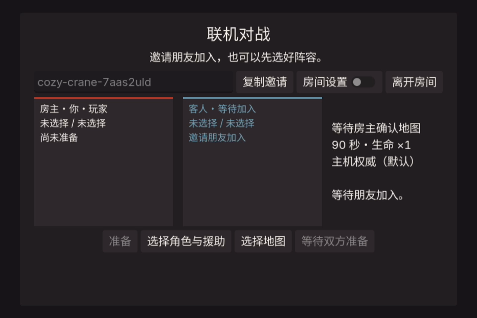

# 死神 vs 火影 2.6

**打开浏览器就能玩的原生 Web 复刻版 · 无需 Flash，无需插件**

### [立即在浏览器试玩 → bvn26.vercel.app](https://bvn26.vercel.app/)

[现在能玩到什么](#现在能玩到什么) · [默认键位与上手](#默认键位与上手) · [双人与好友房联机](#本地双人与好友房联机) · [开发者文档](#开发者与贡献者)

  

  视觉概念插画（AI 生成装饰图，非实机游戏画面）

把记忆里的经典普通版《死神 vs 火影 2.6》（600×400，30 FPS）带回现代桌面浏览器——**不用安装 Flash Player，也不靠 Ruffle 模拟**，打开网页就能以原生 Godot Web 版直接开打。

项目以忠实还原普通 2.6 为目标，仍在持续完善中；详细开发进度与已知差异见 [状态页](docs/STATUS.md)。

---

## 现在能玩到什么

- **40 个可选人物与形态**：覆盖普通 2.6 原版目录的 **35 名基础角色**（鸣人、一护、日番谷、佐助、露其雅、恋次、樱、卡卡西、剑心、白哉、茶渡、小李、宁次、仙鸣、一护2、小乌、手鞠、石田、银、鼬、大蛇丸、蓝染、我爱罗、剑八、自来也、小南、佩恩、带土、一角、迪达拉、重吾、香磷、涅茧利、奇拉比等）与 **5 张独立可选形态卡片**（日番谷万解、露其雅始解、一护万解、鸣人九尾、佐助咒怨），部分角色亦支持战中形态切换。
- **26 名原版辅助（援助）角色**：普通 2.6 原版目录的全部 26 位援助角色均已加入选人阵容。
- **10 张经典战场地图**：现世、流魂街、双极、静涎亭、尸魂界通道、木叶村、温泉、终结之谷（火影瀑布）、楼顶、宇智波一族（宇智波村），附带原版选图界面与背景音乐配置。
- **开放模式**：人机对战（`VS COM`）、同键盘双人（`VS MODE`）、格斗练习（`TRAINING`）、实验性好友房联机（`联机对战`）与游戏/键位设置（`SETTING`）。*（`SINGLE PLAY` 闯关等其余入口暂未开放。）*

  

  复刻版实机画面：一护与鸣人在现世地图对战

---

## 默认键位与上手

沿用普通 2.6 原版默认键位：

| 动作 | P1 默认键位 | P2 默认键位 |
| --- | --- | --- |
| 移动 / 方向 | `W` `S` `A` `D` | `↑` `↓` `←` `→` |
| 近战攻击 / 确认 | `J` | 小键盘 `1` |
| 跳跃 | `K` | 小键盘 `2` |
| 冲刺 / 瞬步 | `L` | 小键盘 `3` |
| 远程攻击 | `U` | 小键盘 `4` |
| 必杀技 | `I` | 小键盘 `5` |
| 召唤辅助 | `O` | 小键盘 `6` |

**上手提示**：
- 游玩前请切换为**英文输入法**（游戏按物理键位采样，可避免输入法吞键）。
- 无小键盘设备可在 **`SETTING`** 中随时改键。
- 首次点击画面后解锁音效，窗口切走会自动暂停，支持全屏游玩。

---

## 本地双人与好友房联机

  

  复刻版实机画面：好友联机房间界面（邀请码与等待朋友加入状态）

- **同屏双人（`VS MODE`）**：一台电脑直接双人开打，支持在 **`SETTING`** 自由调整 P1 / P2 键位。
- **好友房联机（`联机对战`，实验性）**：在主菜单进入「联机对战」即可创建好友房间，将邀请码或链接发给朋友，待对方加入后各自选角、选辅助，再由房主确认地图开局；房间支持主机权威与回滚两种模式（详见 [联机说明](docs/online-multiplayer/README.md)）。

---

## 开发者与贡献者

本项目基于原生 **Godot 4.7.2 + WebAssembly** 构建，本地运行、构建校验、仓库结构与普通 2.6 基准等工程文档已整理在独立目录：

- **[开发者指南（docs/DEVELOPMENT.md）](docs/DEVELOPMENT.md)** — 环境要求、本地构建与预览、校验命令、联机服务与仓库结构
- **[接手与贡献约定（AGENTS.md）](AGENTS.md)** · **[技术规格（SPEC.md）](SPEC.md)** · **[实施计划（IMPLEMENTATION_PLAN.md）](IMPLEMENTATION_PLAN.md)**
- **[架构设计](docs/ARCHITECTURE.md)** · **[源优先闸门](docs/SOURCE_FIRST.md)** · **[操作与导入手册](docs/OPERATIONS.md)** · **[联机客户端说明](docs/online-multiplayer/CLIENT_IMPLEMENTATION.md)**
