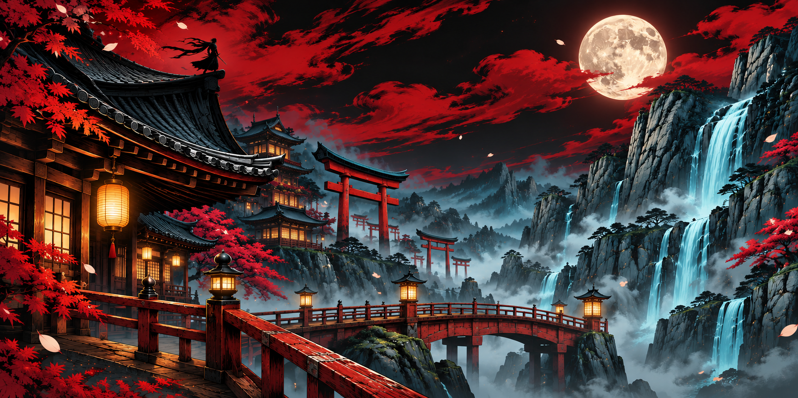

# 死神 vs 火影 2.6

**打开浏览器就能玩的原生 Web 复刻版 · 无需 Flash，无需插件**

### [立即在浏览器试玩 → bvn26.vercel.app](https://bvn26.vercel.app/)

[现在能玩到什么](#现在能玩到什么) · [默认键位与上手](#默认键位与上手) · [双人与好友房联机](#本地双人与好友房联机) · [当前进度说明](#当前进度与诚实说明) · [开发者文档](#开发者与贡献者)

  

  视觉概念插画（AI 生成装饰图，仅作页面视觉氛围展示，非实机游戏截图或 1:1 还原证明）

把记忆里的经典普通版《死神 vs 火影 2.6》（600×400，30 FPS）带回现代桌面浏览器——**不用安装 Flash Player，也不靠 Ruffle 模拟**，直接以原生 Godot Web 版在浏览器里开打。

本项目以尽量忠实复刻普通 2.6 为目标，目前仍在持续打磨与逐项核对中。你现在就可以直接点开网页来一局人机切磋、和朋友同键盘对战，或者试试实验性的好友房联机。

---

## 现在能玩到什么

- **40 个可选人物与形态**：覆盖普通 2.6 原版目录的 **35 名基础角色**（鸣人、一护、日番谷、佐助、露其雅、恋次、樱、卡卡西、剑心、白哉、茶渡、小李、宁次、仙鸣、一护2、小乌、手鞠、石田、银、鼬、大蛇丸、蓝染、我爱罗、剑八、自来也、小南、佩恩、带土、一角、迪达拉、重吾、香磷、涅茧利、奇拉比等）以及 **5 张独立可选形态卡片**（日番谷万解、露其雅始解、一护万解、鸣人九尾、佐助咒怨）；部分角色亦支持战斗内触发原版形态切换。
- **26 名原版辅助（援助）角色**：普通 2.6 原版目录的全部 26 位援助角色均已加入选人阵容。
- **10 张经典战场地图**：现世、流魂街、双极、静涎亭、尸魂界通道、木叶村、温泉、终结之谷（火影瀑布）、楼顶、宇智波一族（宇智波村），配有原版选图界面与背景音乐配置。
- **已开放的游戏入口**：
  - **`VS COM`**：人机对战
  - **`VS MODE`**：本地同键盘双人对战
  - **`TRAINING`**：格斗练习模式
  - **`联机对战`**（实验性）：创建或凭邀请码加入好友房间
  - **`SETTING`**：自定义按键、音量与画面设置
  - *（原版 `SINGLE PLAY` 闯关等其余入口暂未开放。）*

  

  战场氛围概念插画（AI 生成装饰图，仅作视觉装饰，非实机地图或角色截图）

---

## 默认键位与上手

默认键位沿用普通 2.6 原版操作：

| 动作 | P1 默认键位 | P2 默认键位 |
| --- | --- | --- |
| 移动 / 方向 | `W` `S` `A` `D` | `↑` `↓` `←` `→` |
| 近战攻击 / 确认 | `J` | 小键盘 `1` |
| 跳跃 | `K` | 小键盘 `2` |
| 冲刺 / 瞬步 | `L` | 小键盘 `3` |
| 远程攻击 | `U` | 小键盘 `4` |
| 必杀技 | `I` | 小键盘 `5` |
| 召唤辅助 | `O` | 小键盘 `6` |

**快速上手提示**：
- 游玩前建议切换为**英文输入法**（游戏按物理键位采样，可避免中文输入法拦截按键）。
- 没有小键盘的设备可在主菜单 **`SETTING`** 中随时重映射键位。
- 网页端首次点击画面后解锁音效，窗口切换至后台会自动暂停，并支持全屏游玩。

---

## 本地双人与好友房联机

  

  双人对战与好友房联机概念插画（AI 生成装饰图，仅作视觉装饰，非实机画面或联机实测截图）

- **同屏双人（`VS MODE`）**：一台电脑直接双人开打，默认保留原版 P1 / P2 键位；没有小键盘的笔记本也能在 **`SETTING`** 里自由改键。
- **实验性好友房联机（`联机对战`）**：在主菜单进入「联机对战」，即可**创建好友房间**并把短邀请码或链接发给朋友，等待对方加入后各自选角选辅助、由房主确认地图与规则开局（房间默认使用主机权威模式，亦可在房间设置中切换回滚联机）。
- **如实边界**：目前真实的创建房间、凭码加入与等待对手流程已经接通；**跨公网完整双人浏览器实战、弱网与中继路径及延迟表现仍在测试与验证中**，暂不将其宣称为已通过完整验收的稳定联机版本（详见 [联机说明](docs/online-multiplayer/README.md)）。

---

## 当前进度与诚实说明

本项目以忠实复刻普通 2.6 原版为方向，但**当前仍处于持续开发与验证阶段，尚未宣称达到“已证明 1:1 音画等价”或“正式完结”**：

- 仓库内用于发布准入与原版等价证明的六项内部验收标志目前均保持 **`false`**。
- 40 个可选人物/形态与 26 个辅助均已接入选人目录并进行了多轮同输入对照，但部分视觉细节、镜头震动、大招演出、跨浏览器实测（如 Firefox / Safari）、全模式闭环与联机实战验证仍在持续推进。
- 详细的实时进展、对照证据与未结差异见 [当前状态与差异台账](docs/STATUS.md)。

---

## 开发者与贡献者

本项目基于原生 **Godot 4.7.2 + WebAssembly** 构建，运行时不含 Flash 或 Ruffle，采用从锁定普通 2.6 SWF 编译的「源优先」工程路线。技术细节、本地构建、校验命令、仓库结构与联机服务端说明已整理至独立文档：

- **[开发者指南（docs/DEVELOPMENT.md）](docs/DEVELOPMENT.md)** — 环境要求、本地构建与预览、资料/契约校验、联机服务启动、仓库结构与普通 2.6 基准说明
- **[接手与贡献约定（AGENTS.md）](AGENTS.md)** · **[技术规格（SPEC.md）](SPEC.md)** · **[实施计划（IMPLEMENTATION_PLAN.md）](IMPLEMENTATION_PLAN.md)**
- **[架构设计](docs/ARCHITECTURE.md)** · **[源优先闸门](docs/SOURCE_FIRST.md)** · **[操作与导入手册](docs/OPERATIONS.md)** · **[联机客户端说明](docs/online-multiplayer/CLIENT_IMPLEMENTATION.md)**
