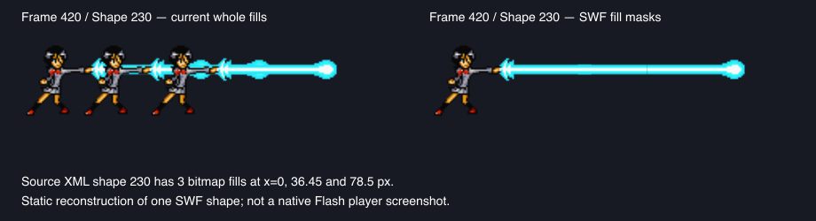

# Rukia U bitmap-fill clipping investigation r01

## Finding

The repeated Rukia figures in the current Godot rendering are leaked pixels from the composite U-attack bitmap fills. They are not accumulated root-timeline instances. The locked SWF's `DefineSprite_533` advances one attack image at depth 27 or 28, replacing the image at that depth as the beam grows. For example, frame 420 has one depth-28 attack image (`character_id=230`) plus the separate `zh1atm` hit clip at depth 29.

`DefineShape2 230` is a 3-fill composite. Its three bitmap fills are bitmap 226 at x=0 twips, bitmap 222 at x=729 twips, and bitmap 222 at x=1570 twips. The edge records divide the shape into three rectangles (x/y in twips): `[0,2031] × [0,940]`, `[1860,2730] × [-5,935]`, and `[2730,4270] × [-5,935]`. After applying each bitmap matrix, those source masks occupy x ranges `[0,101.55]`, `[93,136.5]`, and `[136.5,213.5]` pixels in the shape. The later bitmap copies therefore contribute only their beam sections; drawing each complete source texture exposes the embedded left-end character again at each translated fill.

The JPEXS shape excerpt is retained in `shape230.xml`. It came from `game/fighter/rukia.swf` SHA-256 `c48d47a817dbf1b4fff9b333bb35d89debb64d0635e8d88b4a7d1228208194eb` using JPEXS 26.2.1 XML export 3.2. The source input itself remains unchanged.

The same source textures and transforms are shown before and after applying the extracted fill regions below. This is a static SWF-shape reconstruction used to inspect clipping, not an original-player capture.

## Source-first five questions

1. **Frame scripts and clip callbacks:** The attack label is `招1`, frames 406–431. Its root `DoAction` records are: frame 407 (`动作 = 1; ql += 5`), frame 414 (`_root.shine(2798587)`), frame 426 (`动作 = 0`), and frame 431 (`gotoAndStop("站立"); play();`). Frames 406–430 not listed here have no root `DoAction`. There are no `onClipEvent(enterFrame)` or `onClipEvent(load)` records placed by this root label. Source: `scripts/fighter/rukia.json`, paths `DefineSprite_533/frame_{407,414,426,431}/DoAction.as`; the sprite placements and labels are in `data/slices/rukia-base.timeline.json`.
2. **PlaceObject/MOVE lifetime:** Frame 406 updates depth 27 with image 211; frames 408, 410, 412, 414, 415 replace that same depth with images 213, 215, 217, 219, 221. Frame 416 removes depth 27 and places image 223 at depth 28; subsequent frames replace or remove those display-list entries. Frame 420 uses image 230 at depth 28, and frame 426 removes depths 28 and 29 before placing image 236 at depth 27. The separate `zh1atm` is placed at depth 29 on frame 414 and its matrix grows through frame 424. No sequence appends one whole character image per frame at distinct depths.
3. **Label exit:** Frame 431 unconditionally executes `gotoAndStop("站立")` followed by `play()`. The attack does not end by natural fallthrough at frame 431. Source: `DefineSprite_533/frame_431/DoAction.as`.
4. **Source invariant and assertion:** A composite shape must draw each bitmap only inside that fill's SWF edge region. Shape 230's translated fills are beam extensions; their fill boundaries clip away the repeated left-end figure. The regression asserts the three source-derived polygons, not a guessed number of visible afterimages. A single-frame depth-27/depth-28 overlap at frame 417 is present in the source and is not treated as an error by this fix.
5. **Same-input original-player check:** The existing original-player capture `evidence/characters/rukia/base-move-reference-r02/rukia-406-magichit1-neutral/` runs the fixed input with the P1 ranged/U key (key code 85) pressed at fight tick 10. In `events.jsonl.gz`, tick 10 records key code 85 as pressed and tick 11 enters Rukia frame 406; following rows advance through the attack frames. `comparison.json` records 602 source rows and 602 Godot rows, exact on all 14 captured fighter fields with no differences. `case.json` records the source action `招1` and 300-frame input. This verifies the same-input action/position behavior. It is not a native-player screenshot and does not establish full visual or browser parity; the user's screenshot is the observed broken Godot presentation.

## Validation scope

The change compiles per-bitmap-fill polygons for supported closed contours and draws each fill through its compiled mask. Unsupported/open or ambiguous paths retain the previous renderer path; this evidence does not claim that every SWF fill topology is now supported. The acceptance claim is limited to fixing the leaked bitmap-fill content that repeats Rukia in this U attack, with regression coverage for the composite fill geometry and the existing overlapping-fill sample `shape107`.

## Served Web follow-up

The first post-fix user retest still showed repeated figures because `127.0.0.1:8765` was serving the older `/private/tmp/bvn-web-export` copy, not the newly exported `dist/web`. Before synchronization its PCK SHA-256 was `9e0370f9329251143cee9b048042bdf7ecbeec34c490d4bc078f18cedb87f39d`; after copying the current export, the server returned the same 87,937,268-byte PCK as `dist/web` with SHA-256 `a8b23a7be1a5e4ddf1fac2c0bd54d782ab931c89ffb8b9a158d5b3a08e801a0b`. The same controllable in-app browser tab was reloaded and reached the Godot title artwork. It did not reach combat, so the U rendering after this deployment remains visually unverified. See `validation-web-sync.log` and `validation-web-build.log`.
