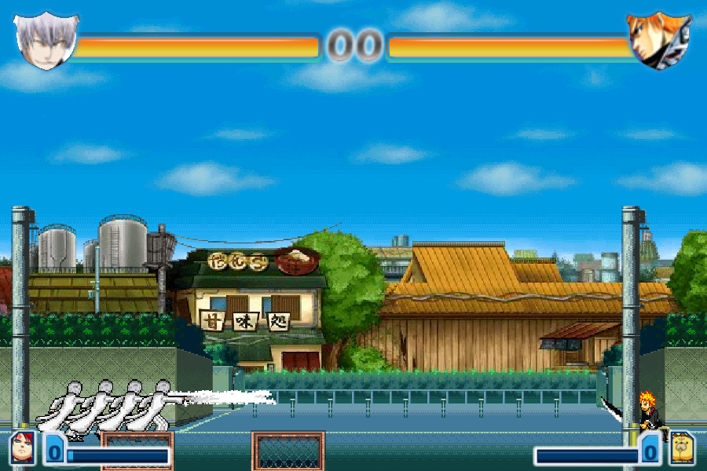
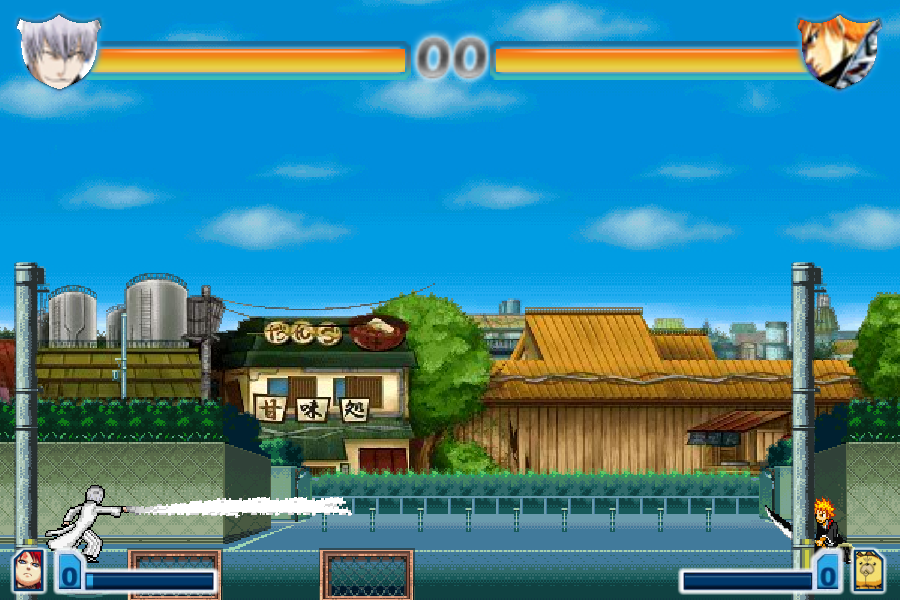
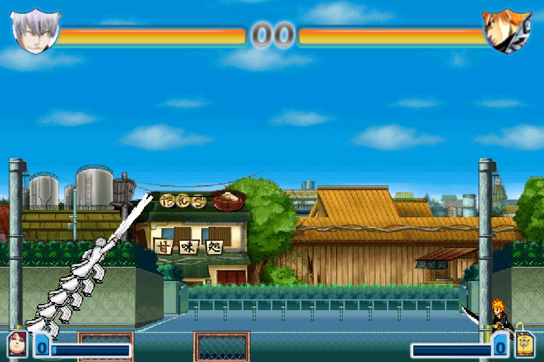
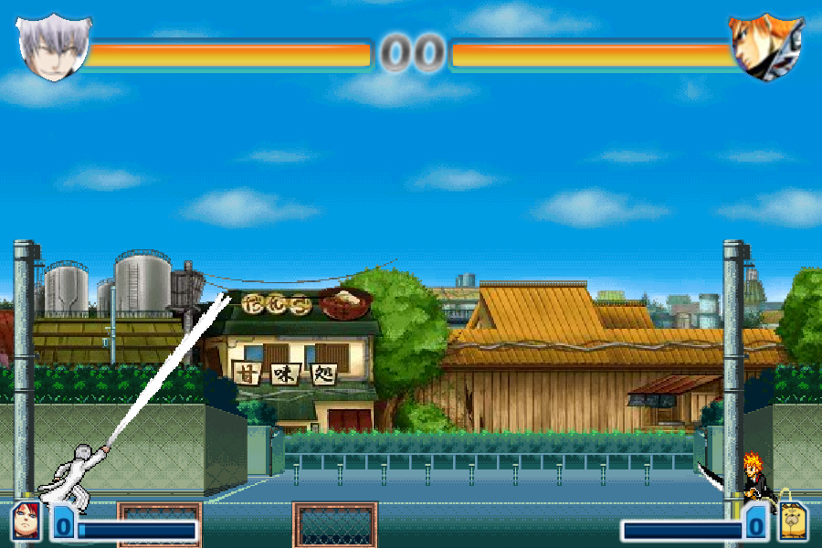

# Bitmap placeholder masks (2026-10-13)

Gin's U and up+U rendered full copies of the body where the source draws only
blade fragments. A bitmap fill with `bitmapId=65535` and no edges made the
shared contour compiler reject the entire shape. The renderer then drew each
remaining fill as a complete bitmap.

The compiler now retains an empty contour list for no-bitmap/unused fills,
keeping indices aligned with `bitmap_fills`. The renderer skips explicit empty
masks. A single contour exactly covering the bitmap rectangle retains Sprite2D
rendering (including transformed rectangles); partial contours use Polygon2D.
Unsupported nonempty/open/ambiguous contours retain the existing fallback.
No movement, hitbox, shadow/afterimage, timing or combat behavior was changed.

## Source-first audit

1. `scripts/fighter/yin.json`, Sprite 435: U (`招1`) spans 439–485 and up+U
   (`招3`) spans 537–574. [source-frames.json](source-frames.json) lists every
   frame, including empty scripts, original script paths and placement changes.
   U sets action/energy at 440, clears action at 459; up+U does so at 538/552.
   Cancel callbacks at 458/553 can go to `砍1` when `nornalhit()` succeeds.
2. Source shape tags 180/182 and 224/226 are retained as XML fixtures here.
   Their first bitmap fill is the no-bitmap sentinel; it has no boundary.
   Subsequent fills are a body contour plus translated blade contours. Source
   frame placements, MOVE flags and removals are retained in the frame audit;
   this change does not alter their lifetime or callback scheduling.
3. Unconditional source exits at 468 and 564 call `gotoAndStop("站立"); play();`.
   Label end frames are not used as exits.
4. Assertions cover empty-fill suppression, fill-index alignment, the source
   blade contours, exact full-rectangle detection, and actual U/up+U traversal
   of every affected frame. They do not assert guessed movement or hitboxes.
5. The user confirmed these same inputs in native Flash show one Gin plus the
   extending blade. Earlier focused native gameplay traces are linked from
   [Gin's import evidence](../../characters/yin/README.md). This session adds
   production Godot input replays and matched-frame before/after screenshots,
   not a new native Flash pixel capture or full audiovisual parity claim.

## Regeneration and review

[regeneration.json](regeneration.json) records source SWF/XML hashes, changed
shape IDs and output hashes for all 29 timeline artifacts: 14 base fighters
plus the retained Hitsugaya second-form analysis slice. There are 1,790 changed
shape definitions across analysis slices (1,666 in production base timelines).
Affected fighters: Byakuya, Kakashi, Renji, Sakura, Sasuke, Chad, Lee, Naruto,
Neji, Hitsugaya, Rukia, Ichigo, Gin and Uryu.

All source SWF hashes match the locked inputs. Thirteen XML exports match the
old recorded XML hash. Naruto's newly exported XML does not match its historical
XML hash; the export is from the same locked SWF with pinned JPEXS 26.2.1 (XML
3.2). The report retains both XML hashes. Every existing definition's type,
shape bounds and bitmap fill/matrix table was checked against the fresh export.
Only `bitmap_clip_polygon(s)` were refreshed. Historical `source_xml` metadata
continues to identify the original full timeline extraction; the report records
the additional mask provenance. Unrelated newer frame-event and solid-fill
compiler output was deliberately excluded. Assets/intro dependency hashes and
online compatibility fingerprints were refreshed separately.

A semantic diff against commit `46567086` verifies that removing the two mask
fields makes every timeline identical to its baseline. A second regeneration
produces no changes. Original input hashes and baseline traces are untouched.

Reproduce with JPEXS 26.2.1 exports under `<workspace>/<SWF stem>/<stem>.xml`:

```sh
python3 tools/importer/refresh_bitmap_masks.py --workspace /tmp/bitmap-placeholder-mask \
  --report /tmp/mask-regeneration.json data/slices/*-base.timeline.json \
  data/slices/rifagu-form-2.timeline.json godot/generated/fighters/*/timeline.json
python3 -m unittest discover -s tools/tests
godot --headless --path godot -s res://tests/bitmap_placeholder_smoke.gd
godot --path godot -s res://tests/bitmap_placeholder_smoke.gd -- --capture
godot --path godot -s res://tests/bitmap_placeholder_smoke.gd -- --capture --legacy-masks
```

The refresh tool changes only timeline masks. After rebuilding, update each
materialized `assets.json` timeline hash and each fighter `intro.json` source
hash, run `tools/build_online_manifest.py`, and update reviewed manifest hashes.
Temporary exports, logs and tool installations remain under `/tmp`.

## Verification

Python: 283 tests, 2 skipped, all others passed. Package integrity, handoff,
contracts and online-manifest checks pass. Ten selected existing Godot smokes,
the 1,648-shape mask corpus/input smoke, and the existing native bitmap pixel
test pass. See [checks.json](checks.json) for results, retained log hashes and
limitations.
The Godot version is 4.7.2-stable, macOS Apple M2, Compatibility/OpenGL. The
production fixture uses Gin vs Ichigo, Gaara/Kon helpers and the current-world
stage; natural intro, explicit source clock, seed 727, then three ticks of U
or up+U. The opponent is moved out of contact range to isolate rendering.
Screenshots are at source frames 450 and 545, rendered at 900×600. The legacy
comparison disables only the four Gin masks, using the same fixture and inputs.

| Input | Legacy mask fallback | Fixed |
| --- | --- | --- |
| U |  |  |
| Up+U |  |  |

Both fixed screenshots show a single Gin with an extending blade. The existing
Hitsugaya ice-exclusion pixel test also passes. Full-roster native pixel parity
remains unmeasured; broader M1/M6 acceptance stays pending. Five unrelated
pre-existing Godot smoke failures are documented separately, not counted as
passes. PR #8 (Ikkaku) is open; PR #7 (Neji) is merged into the baseline. Their
generated timeline/manifest work may conflict and should be regenerated after
merging instead of resolving hashes by hand.
